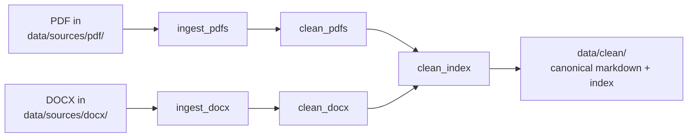

# dagster-elt-template

[](LICENSE)
[](https://www.python.org)
[](https://dagster.io)

A [Dagster](https://dagster.io)-based template for converting PDFs and
DOCX files into clean, ingestible markdown. Drop source files into
`data/sources/{pdf,docx}/`, run the pipeline, and the normalised content
appears in `data/clean/` with YAML frontmatter, `meta.json` per item,
and a regenerated cross-type search index.

Use this template when you want to:

- Convert a batch of PDFs and DOCX files to markdown via a reproducible
  pipeline (not a one-off script).
- Keep the conversion observable in the [Dagster UI](https://dagster.io)
  with full lineage from source file → clean item.
- Produce canonical, git-tracked markdown that any downstream consumer
  (RAG, search index, static site, analysis) can read.

See [LICENSE](LICENSE) for terms.

## Quickstart

Requires macOS or Linux, [Homebrew](https://brew.sh), and Python 3.12+.

```bash
brew bundle --file=scripts/Brewfile   # direnv, uv, just, lefthook, …
direnv allow                          # load .envrc (DAGSTER_HOME + venv PATH)
just install                          # uv sync — Python deps
just dev                              # open the Dagster UI
```

This project is shaped for AI-assisted development: every workflow is
observable, every command is reproducible, every tool choice is
deliberate. The selection of building blocks matters.

## Pipeline



## Working with the data

```
data/
├── sources/    # gitignored, raw file conversions — write-only
│   ├── pdf/    # *.pdf + their raw .md conversions
│   └── docx/   # *.docx + their raw .md conversions
└── clean/      # tracked, canonical markdown + meta.json — read by all consumers
```

Ingestors write to `data/sources/`; everyone else reads from
`data/clean/`. Adding a new source or consumer, schema details, and the
layer invariants all live in
[`docs/data-architecture.md`](docs/data-architecture.md) and
[`docs/data-schema.md`](docs/data-schema.md).

## Adding your own files

1. Drop a `.pdf` into `data/sources/pdf/` (or `.docx` into
   `data/sources/docx/`).
2. Open the Dagster UI: `just dev`.
3. Launch the **`full_pipeline`** job.
4. The clean output appears in `data/clean/{pdf,docx}-document/{stem}/`
   — one `{stem}.md` (YAML frontmatter + body) and one `meta.json` per
   source file.

## Commands

| Recipe | What it does |
| --- | --- |
| `just install` | `uv sync` — install Python deps |
| `just dev` | Launch the Dagster UI |
| `just check` | `ruff check` + `ruff format --check` + `ty check` + `pytest` (read-only, CI-safe) |
| `just fix` | Auto-fix lint and reformat |
| `just open` | Open `data/` in Finder |
| `just hooks-install` | Wire lefthook into `.git/hooks` (once after cloning) |

## Contributing

Only validation is running `just check` before opening a PR — it must
pass. The same checks run automatically on git pre-commit. To glance
over the project structure, start with
[`docs/data-architecture.md`](docs/data-architecture.md) for
architecture and [`docs/data-schema.md`](docs/data-schema.md) for
schema questions.

## Extending

- **New source type** — see "How to Add a New Source Type" in
  [`docs/data-architecture.md`](docs/data-architecture.md).
- **New consumer** — read from `data/clean/_index.json` for an
  overview, then individual items at
  `data/clean/{content-type}/{stem}/`. Never read from `data/sources/`.
- **Per-file partitions** — the current design runs the pipeline over
  whole source directories. To re-run a single file's conversion,
  follow the
  [dynamic partitions pattern](https://docs.dagster.io/concepts/partitions-schedules-sensors/dynamic-partitions)
  with a sensor that scans the source directory on each tick.